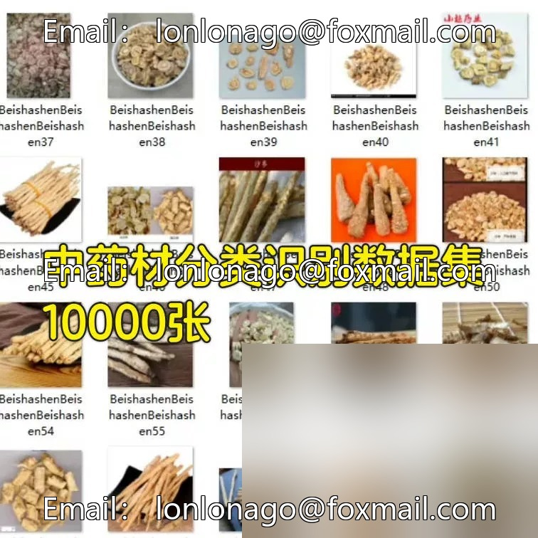
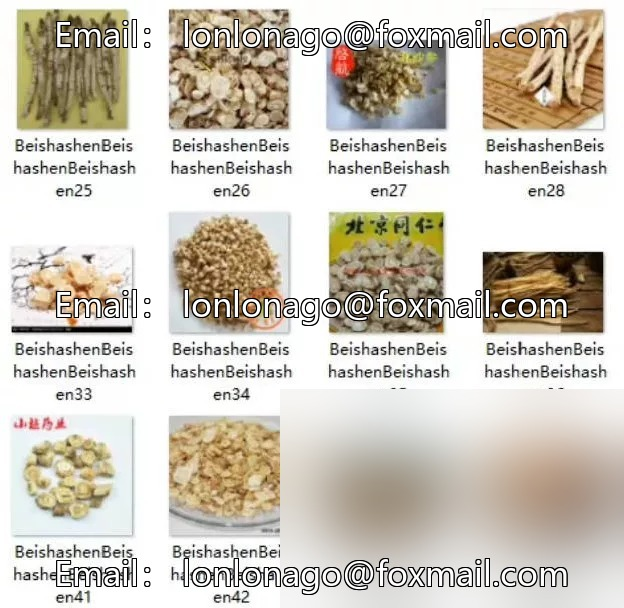
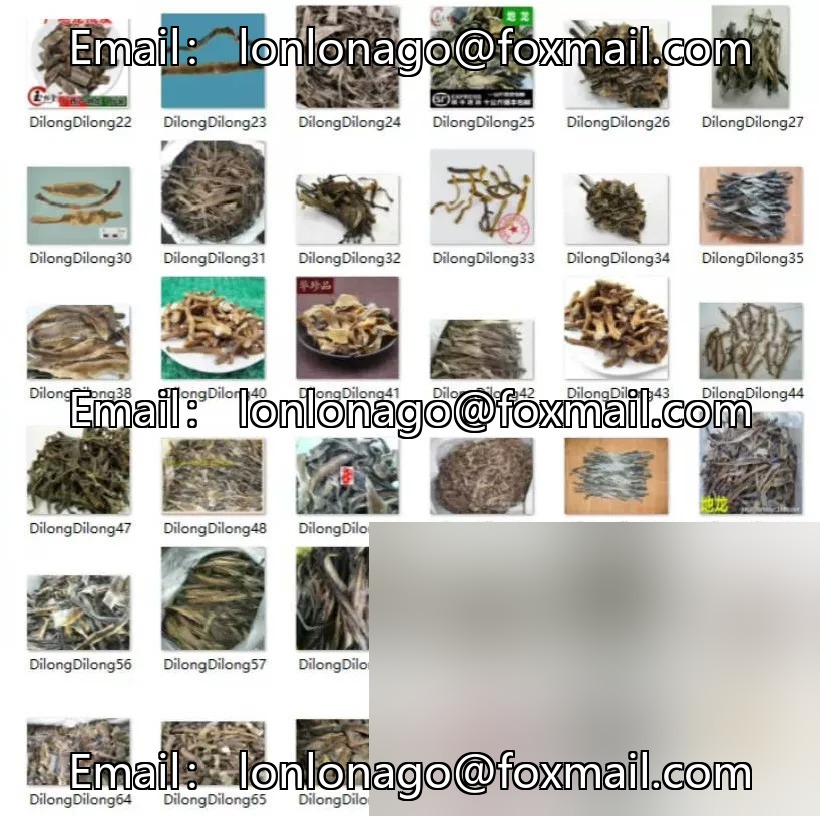
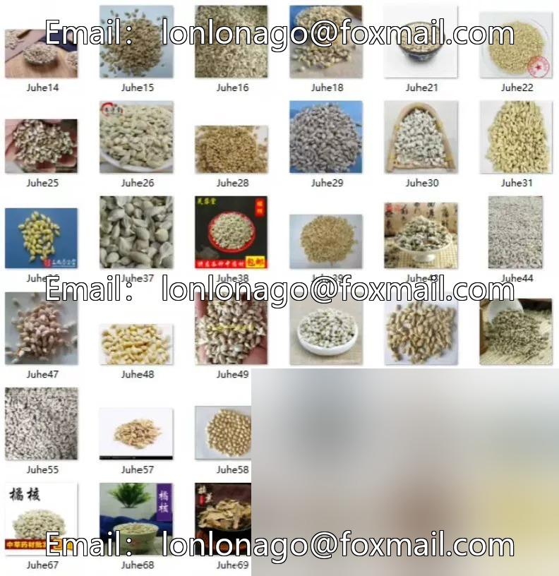

# Medicinal Chinese material classification recognition dataset, 100 medicinal materials labels, with a total of 1000 for training and testing.

## Body

Medicinal material classification recognition dataset, 100 kinds of medicinal materials labels, training and testing total 10,000 pictures, can be used for applications such as data classification and medicinal material recognition.

web-based shipment, can be directly photographed and shipped.

The dataset has 100 herbal labels with a total of 10,000 training and testing samples, available for data classification and herbal recognition; an online warehouse shipment is available.

<!-- AI_ENRICHED -->

## Images

## Payment

Here is a pay link on Stripe ( https://buy.stripe.com/3cs8yP7sY87d0vu9AB ). Please contact me lonlonago@foxmail.com after funding $89, and I will send you a complete data files , thank you!

